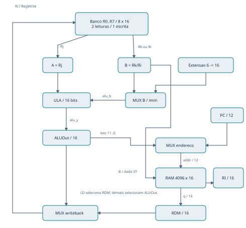
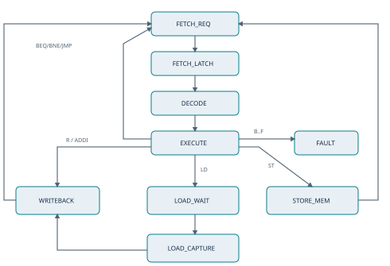

# CPU16 - Especificação técnica

## Especificação do projeto

Laboratório de Arquitetura de Sistemas ComputacionaisPlataforma: Terasic DE2-115 | Linguagem: VHDL | Versão: 30/10/2026

Identificação do grupo: preencher número, turma e nomes dos 4 a 5 integrantes antes da entrega. Este documento registra a implementação produzida com assistência de IA; a validação física ainda deve ser realizada pelo grupo.

| Entrega técnica | Situação nesta versão |
| --- | --- |
| ISA, caminho de dados e controle | Implementados em VHDL |
| Programas e assembler | 7 programas; arquivos .asm, .mif, .hex e listagens |
| Simulação RTL | 17 execuções de testbench aprovadas |
| Síntese genérica do núcleo | Executada com GHDL; não equivale ao fitter Quartus |
| Quartus e placa física | Projeto preparado; compilação e testes pendentes |

Topologia. Arquitetura de memória unificada: instruções e dados compartilham uma RAM síncrona de 4096 palavras. Um banco de oito registradores fornece operandos à ULA. Registradores internos preservam instrução, operandos e resultados entre estados. A unidade de controle é uma máquina de estados descrita em cpu_core.vhd. Não há pipeline, interrupções ou cache.

Execução. A CPU usa CLOCK_50 continuamente. KEY1 gera um clock-enable filtrado; cada aperto avança um estado. Essa organização permite observar a execução nos LEDs sem distribuir o sinal mecânico como clock. O programa padrão começa com ADDI R1,R0,10.

Limite da evidência. Os resultados deste documento são de simulação e de síntese genérica do núcleo. Não foram medidos frequência máxima, ocupação final ou comportamento elétrico na FPGA. Não há arquivo .sof validado nesta versão.

## Registradores e conjunto de instruções

| Registradores | Quantidade / bits | Endereço ou seleção |
| --- | --- | --- |
| R0 a R7 | 8 x 16 | 000, 001, 010, 011, 100, 101, 110, 111 |
| PC e IP | 2 x 12 | Internos; PC exibido com extensão por zeros |
| RI, A, B, RDM, ALUOut | 5 x 16 | Internos, não endereçáveis pelo programa |
| Estado da UC | 9 estados | Enumeração; código físico definido na síntese |

Todos os registradores R0..R7 são graváveis e zeram no reset. IP preserva o endereço da instrução atual. A recebe Rj; B recebe Rk no tipo R e Ri para ST/BEQ/BNE.

| Formato | Campos / posições de bits |
| --- | --- |
| R | opcode [15:12] | Ri [11:9] | Rj [8:6] | Rk [5:3] | 000 [2:0] |
| I | opcode [15:12] | Ri [11:9] | Rj [8:6] | imediato [5:0] |
| J | opcode [15:12] | endereço absoluto [11:0] |

| Opcode | Instrução | Efeito |
| --- | --- | --- |
| 0 | ADD Ri,Rj,Rk | Ri = (Rj + Rk) mod 65536 |
| 1 | SUB Ri,Rj,Rk | Ri = (Rj - Rk) mod 65536 |
| 2 | AND Ri,Rj,Rk | AND bit a bit |
| 3 | OR Ri,Rj,Rk | OR bit a bit |
| 4 | SLT Ri,Rj,Rk | Ri = 1 se signed(Rj) < signed(Rk), senão 0 |
| 5 | ADDI Ri,Rj,imm | Ri = (Rj + sext(imm)) mod 65536 |
| 6 | LD Ri,Rj,imm | Ri = RAM[(Rj + sext(imm)) mod 4096] |
| 7 | ST Ri,Rj,imm | RAM[(Rj + sext(imm)) mod 4096] = Ri |
| 8 | BEQ Ri,Rj,imm | Se iguais: PC = (IP + imm) mod 4096 |
| 9 | BNE Ri,Rj,imm | Se diferentes: PC = (IP + imm) mod 4096 |
| A | JMP end | PC = end |
| B a F | Reservados | Entram em FAULT até reset |

Opcodes em hexadecimal. Imediato com sinal: -32..+31. Exemplo: ADDI R1,R0,-1 = 523F. Bits não usados do tipo R são ignorados pelo hardware. Sem flags de overflow e sem delay slot.

## Caminho de dados

Seleção e escrita. O mux de endereço escolhe PC durante a busca ou ALUOut[11:0] para LD/ST. O mux da entrada B da ULA escolhe o operando salvo ou o imediato estendido. O mux de writeback seleciona RDM para LD e ALUOut nas operações aritméticas e lógicas.

Controle não desenhado nos barramentos. RI fornece opcode, índices e imediato. A UC habilita as capturas e a escrita em memória. Os campos do RI selecionam o banco, o extensor e a função da ULA. As linhas que se cruzam sem ponto de junção não representam conexão.

Atualização do PC. Em FETCH_LATCH: IP recebe PC e PC recebe PC+1. Em EXECUTE: JMP seleciona RI[11:0]; BEQ/BNE tomados selecionam IP+imm. Somadores de endereço do PC são separados da ULA de dados. PC e endereços efetivos usam aritmética módulo 4096.

Observação. PC alimenta HEX3..0. RDM e ALUOut alimentam um mux controlado por SW17 para HEX7..4. ALUOut é a saída registrada da ULA, mantida estável entre passos.

## Unidade de controle: estados

Toda transição depende de step=1 na borda de subida de CLOCK_50. Com step=0, CPU e estado permanecem estáveis. Reset tem prioridade e leva a FETCH_REQ de qualquer estado; FAULT permanece até reset. Essas condições globais foram omitidas das setas para manter a legibilidade.

| Estado / LEDG | Ação no próximo pulso | Próximo estado |
| --- | --- | --- |
| FETCH_REQ / 0 | Endereço PC disponível à RAM | FETCH_LATCH |
| FETCH_LATCH / 1 | RI=RDM=q; IP=PC; PC=PC+1 | DECODE |
| DECODE / 2 | A=Rj; B=Rk ou Ri | EXECUTE |
| EXECUTE / 3 | ALUOut=ULA; resolve tipo e salto | Conforme opcode |
| LOAD_WAIT / 4 | Mantém endereço efetivo para leitura | LOAD_CAPTURE |
| LOAD_CAPTURE / 5 | RDM=q | WRITEBACK |
| WRITEBACK / 6 | Ri=RDM (LD) ou ALUOut | FETCH_REQ |
| STORE_MEM / 7 | RAM[endereço efetivo]=B | FETCH_REQ |
| FAULT / 8 | Bloqueia avanço e escrita | FAULT |

Ciclos habilitados por instrução: ADD/SUB/AND/OR/SLT/ADDI = 5; ST = 5; LD = 7; BEQ/BNE/JMP = 4. “Ciclo” aqui significa um avanço de estado; entre apertos podem transcorrer muitos ciclos físicos de 50 MHz.

## Sinais, memória e temporização

| Sinal / largura | Significado e condição |
| --- | --- |
| clk / 1 | Clock de 50 MHz distribuído à CPU, RAM e filtro do botão |
| reset / 1 | Reset interno ativo alto; prioridade sobre step; não limpa a RAM |
| step / 1 | Pulso de um ciclo após pressionar KEY1 de forma estável |
| mem_addr / 12 | PC, exceto LOAD_WAIT/LOAD_CAPTURE/STORE_MEM: ALUOut[11:0] |
| mem_data / 16 | B, contendo Ri para ST |
| mem_q / 16 | Saída da RAM síncrona |
| mem_we / 1 | STORE_MEM AND step AND NOT reset |
| op / 4 lógicos | Opcode de RI; seleciona operação e fluxo |
| ri, rj, rk / 3 lógicos | Seletores do banco extraídos de RI |
| alu_b / 16 | sext6 para ADDI/LD/ST; B para outras instruções |
| alu_y / 16 | Resultado combinacional antes da captura em ALUOut |
| leds / 9 | Um LED aceso para o estado atual |
| regs_debug / 128 | Saída para verificação; não conectada no top físico |

Habilitações internas. IRWrite, RDMWrite, RegWrite e PCWrite são condições implícitas no processo sequencial, não portas separadas: RI/IP em FETCH_LATCH; RDM em FETCH_LATCH ou LOAD_CAPTURE; banco em WRITEBACK; PC em FETCH_LATCH ou EXECUTE de salto tomado/JMP. A/B carregam em DECODE, ALUOut em EXECUTE. Todas são condicionadas a step.

Leitura síncrona. A RAM recebe clock mesmo enquanto a CPU está pausada. Em execução contínua, FETCH_REQ e LOAD_WAIT garantem a latência de leitura antes da captura. ST só escreve na borda com mem_we=1, evitando repetição de escrita durante a pausa em STORE_MEM.

Inicialização. A arquitetura Quartus usa altsyncram em SINGLE_PORT, saída sem registrador adicional e arquivo program.mif. A arquitetura de simulação reproduz leitura síncrona e lê uma imagem HEX simples gerada a partir do mesmo assembly. Ambas têm 4096 palavras de 16 bits. Endereços não usados são F000.

Reset e limites. KEY0 solicita reset; a liberação é sincronizada. Reset zera registradores, PC, RI e estado, mas mantém dados já escritos na RAM. Para reinicializar o programa/dados, regravar a configuração. Como não existe proteção de memória, ST pode alterar código; os testes usam áreas de dados separadas.

## Testes e critérios de aprovação

Os programas são montados por assemble.py e executados por reference.py, um modelo sequencial independente da FSM. O testbench compara PC e os oito registradores após cada instrução, além do endereço e dado de cada ST. Valores finais dirigidos também são comparados com expectativas escritas explicitamente em prepare_tests.py.

| Programa | Objetivo | Resultado dirigido / esperado |
| --- | --- | --- |
| 01_isa 13 instruções | 11 instruções; R0 gravável; LD/ST em FFF | R0=0001; R3=0007; R6=FFFF; RAM[FFF]=0007 |
| 02_branches 16 instruções | Loop negativo; BEQ/BNE tomados e não tomados | R1=0000; R2=0003; R7=0000 |
| 03_limits 18 instruções | SLT com sinal, overflow, imm -32/+31 | R1=8000; R2=8000; R3=0001; R5=FFFF |
| 04_offsets 7 instruções | Deslocamentos de salto +31 e -32 | R1=0001; R2=0007; R3=0009 |
| 05_random 206 instruções | 200 operações; semente fixa 20261030 | R1=00D5; R2=00E8; R5=01E8; R6=0100 |
| 06_pc_wrap 5 instruções | Incremento de PC em FFF | PC retorna a 000; R1=0001 |
| 07_branch_wrap 3 instruções | BEQ -1 no endereço 000 | Alvo FFF, seguido de JMP 001 |

Modos. Cada um dos sete programas roda com step sempre ativo e com step ativo uma vez a cada sete clocks. O segundo modo verifica retenção do estado durante pausas e ausência de escritas indevidas. Total: 268 instruções por modo, 536 comparações de aposentadoria no RTL.

| Testbench adicional | Verificações |
| --- | --- |
| tb_button | Bounce curto, pressão longa, soltura, segunda pressão e reset |
| tb_fault | Opcode inválido, retenção em FAULT, recuperação e reset durante execução |
| tb_top | Cinco apertos, PC=0001, RDM=520A, ULA=000A, SW17 e reset |

O teste top usa filtro reduzido para quatro ciclos; a configuração física usa 500000. O teste de bounce é digital e não substitui avaliação elétrica. Todos os testes têm asserções; o teste da CPU inclui timeout.

## Resultados, discussão e uso de IA

Resultados executados em 30/10/2026. GHDL 4.1.0, backend mcode, VHDL-2008: análise e elaboração aprovadas; 14 execuções da CPU mais três testbenches de suporte aprovados. Nenhuma asserção falhou na execução final. Os logs reais estão em results/ghdl.log e results/reference.log. O núcleo cpu_core também passou por ghdl --synth; o adaptador altsyncram não foi sintetizado por essa verificação.

Discussão. A comparação a cada instrução detecta erros transitórios que poderiam desaparecer no valor final. Os testes de desvio distinguem claramente IP de PC já incrementado. O teste com pausas confirma que o ritmo humano não altera a semântica. Os casos de fronteira mostram a política modular de endereços e o comportamento de números negativos.

Limitações. A bateria é finita, não uma prova formal. Não há medição de timing pós-roteamento, consumo, ocupação de LEs/M9Ks ou teste em hardware. A simulação usa modelo comportamental da memória, sem a biblioteca de simulação do fabricante; o adaptador altsyncram e o arquivo QSF ainda precisam ser compilados no Quartus. A pinagem considera a DE2-115 e seus jumpers padrão.

Dificuldades técnicas tratadas nesta implementação. (1) A RAM síncrona exigiu estados de espera e captura separados. (2) O incremento antecipado do PC exigiu IP para saltos relativos. (3) Botão assíncrono exigiu sincronização, debounce e pulso único. (4) ST e desvios usam Ri como fonte, diferentemente das instruções aritméticas. (5) SLT compara operandos signed diretamente para não depender do sinal de uma subtração com overflow.

Dificuldade do ambiente. O simulador não estava disponível inicialmente; uma cópia local de GHDL foi preparada para executar os testes. Quartus e FPGA não estavam disponíveis. Esses são registros da preparação assistida, não experiências atribuídas aos integrantes.

Uso de IA. A IA foi usada para propor a arquitetura, escrever os módulos VHDL, o assembler, o modelo de referência, os programas, os testbenches, os arquivos de projeto e esta documentação. O objetivo foi produzir uma base completa e reproduzível. Também auxiliou na consulta à documentação da placa e na execução dos testes. O grupo deve revisar, compreender, adaptar e validar fisicamente o material, registrando suas contribuições reais.

Antes da entrega. Acrescentar a compilação do Quartus e os resultados físicos na página seguinte; preencher integrantes; discutir divergências e dificuldades realmente vividas pelo grupo. Não converter os campos pendentes em afirmações de sucesso sem evidência.

## Integração e validação na DE2-115

Abrir quartus/cpu16.qpf; usar fpga_top e dispositivo EP4CE115F29C7. Manter apenas os arquivos rtl na síntese. A pinagem e os padrões de I/O foram preparados a partir do manual da placa; conferir JP7=2,5 V e JP6=3,3 V. A SDC define CLOCK_50 com período de 20 ns. [1]

Compilar no Quartus, inspecionar warnings, memória inicializada e timing; gravar o .sof com USB-Blaster/JTAG. Após reset, KEY1 avança um estado; HEX3..0 mostram PC. SW17=0 seleciona RDM e SW17=1 seleciona ALUOut em HEX7..4. LEDs verdes indicam os nove estados. A tabela detalhada de pinagem está em quartus/de2_115_pins.qsf.

| Aperto KEY1 | LEDG | PC | RDM | ALUOut |
| --- | --- | --- | --- | --- |
| Reset | 0 | 0000 | 0000 | 0000 |
| 1 | 1 | 0000 | 0000 | 0000 |
| 2 | 2 | 0001 | 520A | 0000 |
| 3 | 3 | 0001 | 520A | 0000 |
| 4 | 6 | 0001 | 520A | 000A |
| 5 | 0 | 0001 | 520A | 000A |

Roteiro inicial com program.mif padrão. Os valores acima são esperados e também foram verificados em tb_top; ainda não são medições da placa. Apertos devem incluir soltura. No fim do programa, JMP 00E faz PC alternar entre 00E e 00F conforme o estado.

| Registro físico a preencher pelo grupo | Situação atual |
| --- | --- |
| Versão do Quartus, data e responsáveis | Pendente |
| Compilação, LEs, registradores e blocos de RAM | Pendente |
| Slack / Fmax e relatório de timing | Pendente |
| Fotos dos displays e estados | Pendente |
| Testes de LD/ST, desvios e botão na placa | Pendente |
| Problemas observados e alterações realizadas | Pendente |

Referências e rastreabilidade.

[1] Terasic. DE2-115 User Manual, tabelas 4-1 a 4-5 e configuração dos jumpers. Consulta: 30/10/2026. https://www.terasic.com.tw/wiki/images/f/ff/DE2_115_User_manual_2013.pdf

[2] Intel/Altera. Documentação de memória embarcada e altsyncram. Parâmetros SINGLE_PORT, largura, endereço, outdata_reg_a e init_file. Adaptador do projeto requer validação na biblioteca Quartus da instalação local. https://www.intel.com/programmable/technical-pdfs/683423.pdf

[3] Enunciado do projeto fornecido pelo estudante. Logs e código-fonte desta implementação acompanham o pacote; convenções não determinadas pelo enunciado estão explicitadas nas páginas 2 a 5.
